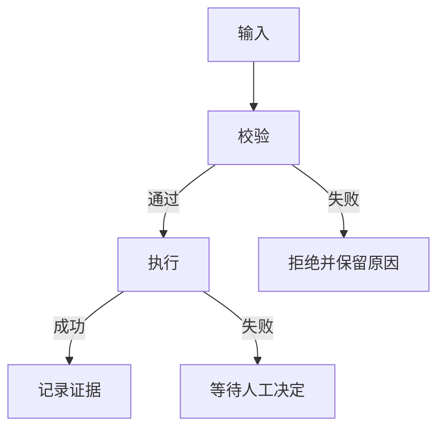

> 本记录遵守 [DELIVERY_POLICY.md](../DELIVERY_POLICY.md) G14；复制到
> `docs/change-records/` 后替换示例元数据和内容。

# 变更记录标题

## 需求与范围

写明用户目标、适用产品/仓库、明确不做的内容及关联仓库。

## 业务逻辑

描述输入、状态、类型化映射、校验、输出、保持不变的业务边。

## 流程

## 安全与失败分支

列出审批、资源锁、固定绑定、超时、原错误、重试和破坏性操作规则。

## 测试报告

| 类型 | 命令/检查 | 结果 | 证据 |
| --- | --- | --- | --- |
| static/software/build/public/hardware | command | NOT-RUN | reason or evidence path |

## 未完成项

明确列出未执行、被阻断或需要实板/人工确认的项目，禁止省略未知状态。

## 交付影响

说明版本、DEB、APT、镜像、Release、重启、回滚及跨仓影响。
