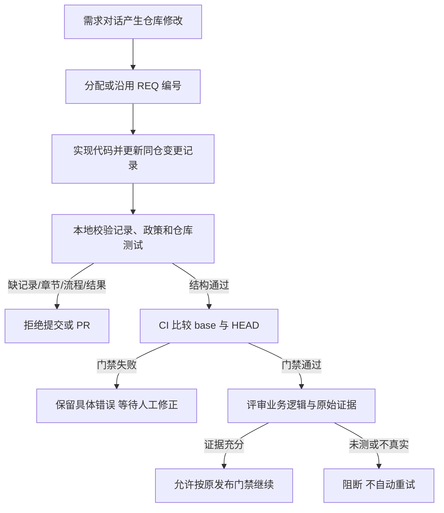

# 三仓会话交付记录门禁

## 需求与范围

为 ArmBianOS、dshanpi-build 和 dspi-config 增加统一强制门禁：每次产生仓库修改的需求会话
必须随 PR 保存需求、业务逻辑、流程、测试和未完成项。本变更只建设治理与 CI 检查，不声称
三个仓库实现了参考需求中的 LYNX UI、FES Loader、GPIO、SSH PTY、Gateway 或设备 AI 功能。

## 业务逻辑

实现会话先分配或沿用稳定 REQ 编号，再同时更新源码与同仓变更记录。记录必须描述输入、状态、
类型化映射、校验、保持不变的边和输出；复杂硬件流程还要保留人工确认、任务与资源锁、固定设备
绑定、有界等待、原始错误码和禁止自动重试等约束。CI 对 base 到 HEAD 的差异取文件集合：
只要存在修改，就必须有同批次 `docs/change-records/CR-*.md`，并验证元数据、章节、Mermaid
流程及带明确结果的测试表。结构通过不替代人工语义评审或实板证据。

## 流程

## 安全与失败分支

门禁只读取 Git 差异和 Markdown，不触碰设备、不发布软件包、不烧录镜像。未知 base 时仍校验
全部已有记录，但不伪造一次差异判断。缺文件、重复记录号、错误仓库角色、非法 REQ、短缺章节、
无 Mermaid 或测试结果不明确均返回非零；错误原文保留给操作者，CI 不自动改写记录或重试业务
操作。记录禁止凭据、私钥、终端正文和个人敏感数据，大日志仅保存受控证据引用。

## 测试报告

| 类型 | 命令/检查 | 结果 | 证据 |
| --- | --- | --- | --- |
| static | `python3 tools/check-delivery-policy.py --peer ...` | PASS | 三仓政策、checker 与 hygiene checker 一致 |
| unit | `python3 tools/test-change-record-policy.py` | PASS | 有效、缺 Mermaid、占位符三项测试通过 |
| diff gate | `python3 tools/check-change-record.py --base origin/main` | PASS | 当前分支全部差异携带有效记录 |
| repository | 仓库原有测试与 hygiene 门禁 | PASS | `test-kernel-headers-btf.py`、A1/CM5 source gate、hygiene、diff check |
| hardware | 实板与烧录功能 | NOT-RUN | 治理变更不触碰硬件 |

## 未完成项

仅剩三个远端 PR CI 和人工评审。本次没有运行镜像构建、APT 发布、公开下载、实板启动或
外设测试；这些不属于治理门禁的通过条件，保持 NOT-RUN，不以治理测试替代产品或硬件验收。

## 交付影响

三个仓库新增相同 G14 政策、记录规范、模板、校验器和 CI 调用，PR 模板及维护技能同步更新。
本变更不修改内核、BSP、DTB、应用载荷或软件包版本，不生成 DEB/镜像，不触发 APT 或 Release，
不要求设备重启。各仓分别提交 PR，全部合并后统一政策哈希和跨仓 checker 才保持一致。
