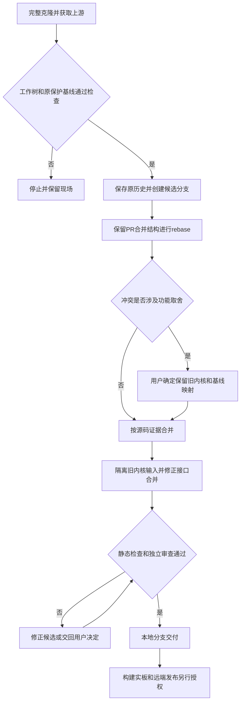

# 将 DShanPI 定制重放到上游构建框架

本记录遵守 [DELIVERY_POLICY.md](../../DELIVERY_POLICY.md) G14。

## 需求与范围

REQ-ARMBIAN-REBASE-001：将 ArmBianOS 的定制提交 rebase 到最新上游 main，解决源码冲突。
用户确认只更新构建框架，保留 A1/CM5 的原内核来源和分支；不同时升级 vendor 内核。
本次仅操作本地源码，不推送远端，不构建、测试、刷写或发布 DEB/APT/镜像。

- 原 fork：`5a8a000b98b6783a3fc6dabf9ce9d2845395c779`。
- 共同基点：`bf9b1368fe5285e5343112eb8ea4403955f7b712`。
- 上游目标：`5d0679d30533efdd32f421aaad2a98363cb9733d`，Armbian `main`。
- 原差距：本仓独有 34 个提交，上游独有 4126 个提交。
- 候选分支：`rebase/upstream-main-20261029`；原历史：`backup/pre-rebase-20261029`。

## 业务逻辑

使用 `git rebase --rebase-merges upstream/main`，保留 28 个普通提交和 6 个 PR 合并提交。
重放完成点为 `c822c63bb`；集成修正另行提交，不覆盖原 main、原备份或已发布历史。

原 A1 基线 `9a3ce1500ea7d149dabd64247afea21cde920ed9` 的四个保护文件保持逐字一致。
用户批准将门禁祖先检查映射到重放后的 `5d7f1a8f1706edde9f2df67e40fff0568bf6bfd7`。
原基线的实板事实不扩展到新的构建框架。

A1/CM5 的 `vendor` 路径继续使用 `dshanpi/linux-rockchip.git` 的 `rk-6.1-rkr5.1`。
新增 `rk35xx-dshanpi-vendor-6.1` 补丁根，保留原两文件，而非叠加新版 rkr7.2 补丁。
其中 `.gitattributes` 保留 unified-diff 的上下文和邮件签名空白。
新增 `linux-rk35xx-dshanpi-vendor.config`，逐字保留原 fork 的内核配置。
CM5 继续追加私有 DTS/overlay 补丁层，保留独立 `rk3576-dshanpi-a1-cm5` 包命名空间。
其他板继续使用上游新 helper、通用内核配置和补丁层；不将旧 DShanPI 内核配置泄漏到其他板。

合并保留 `ENABLE_EXTENSIONS` 与 `EXT` 的并集、CM5 专有 APT 元数据回退，
同时保留上游的扩展 opt-out、Ubuntu/loong64 回退、headers 依赖和构建配置 sidecar。
headers 仍在 `olddefconfig` 后检查 BTF ABI 是否漂移。
音频保留上游通用流程；只有 A1/CM5 使用原 ES8388 控件和系统状态恢复，删除重复调用。
R1 和 Avaota A1 不使用 ES8388 分支，其配置工具/profile/发行扩展入口保留。

## 流程

## 安全与失败分支

- 不 force-push、不修改远端 ref。替换 main 前须另行授权，并保留原历史的远端引用。
- 若保护文件不同，则停止交付；仅从明确的原始基线恢复，不能凭推测重建。
- rebase 冲突保留现场后逐项解决；功能取舍询问用户，不能用整文件盲选替代审查。
- 新 rkr7.2 补丁引用旧内核不存在的文件，故选择隔离旧层，不能仅改 source 后继续混用。
- 静态门禁失败先修复原因，不跳过检查；网络失败允许重试 fetch，不移动原历史。
- 原 DDR v1.09、BL31 v1.20、BL32 v1.06 pins 保留。
  上游提示部分 RK3576 板的 DDR v1.09 有启动风险；本次没有证据支持改动已固定输入。

## 测试报告

静态检查结果见 [原始日志](evidence/REQ-ARMBIAN-REBASE-001-static.log)。
日志覆盖本批次的实际源码，后续仅记录提交不改变被检源码。
集成源码提交为 `18583623c3180bf08077b164bfb3482ac5bf6257`。

| 类型 | 命令/检查 | 结果 | 证据 |
| --- | --- | --- | --- |
| static | `git merge-base --is-ancestor upstream/main HEAD`；核对提交重放数量 | PASS | 原始日志的 history 段 |
| static | 原始与映射检查点、当前四保护路径的 `git diff --exit-code` | PASS | 原始日志的 protected 段 |
| static | 原 fork 的 config/YAML/patch 与新快照 `cmp` | PASS | 原始日志的 snapshots 段 |
| static | `python3 tools/check-delivery-policy.py` | PASS | 原始日志的 policy 段 |
| static | `bash .agents/skills/guard-dshanpi-a1-cm5/scripts/a1_cm5_gate.sh source "$PWD"` | PASS | 原始日志的 source 段 |
| static | 相关 shell/config 的 `bash -n`，不执行构建脚本 | PASS | 原始日志的 syntax 段 |
| static | `git diff --check`、`git diff --cached --check`、仓库 index hygiene | PASS | 原始日志的 index 段 |
| static | `python3 tools/check-change-record.py --base upstream/main` | PASS | 原始日志的 record 段 |
| static | 额外检查 `git diff --check upstream/main..HEAD`，覆盖整个 fork 而非本次修正 | FAIL | camera/multimedia 的历史空白；两个文件与原 fork 一致，见日志 |
| software | 未运行 `tools/test-*.py` 或其他测试 | NOT-RUN | 用户默认不要求执行测试 |
| build | 未运行 kernel/U-Boot/DEB/镜像构建或模块编译 | NOT-RUN | 本次授权仅为源码 rebase |
| public | 未执行 APT、Release 或镜像下载验收 | NOT-RUN | 未发布任何产物 |
| hardware | 未刷写、启动或验证外设、升级和回滚 | NOT-RUN | 没有本次候选的实板证据 |

## 未完成项

新的构建框架尚未经过构建和实板验证。运行时 ALSA numid、外部模块 ABI、启动、
显示、相机、网络与升级/回滚结果仍未知；不能沿用旧版本实板记录标记通过。
本地候选没有推送，也没有替换远端 main。原历史备份的远端保存随后续推送一起处理。
三仓政策未修改，未获取其他两仓 checkout，也未执行跨仓 `--peer` 验证。
整个 fork 对上游的空白检查发现 camera/multimedia 的原有尾随空白。
两文件与原 fork 一致；camera 属于受保护路径，本次不为消除格式告警改变其内容。
本次集成 diff、源码门禁及暂存区空白检查均通过。

## 交付影响

本次交付为可继续评审的本地 rebase 分支和原历史备份，不生成或替换已发布包。
A1/CM5 的源、配置、旧补丁和 RKbin pins 保留；CM5 包命名空间与四板发行接入口保持。
`dshanpi-build` 和 `dspi-config` 无源码改动，已有 lock/tag/DEB 字节不变。
后续发行必须固定本次候选源码，按 G03/G12 提升包版本并验证精确 headers，
再按原三仓流程构建、签名、发布和验收；本次无需设备重启。
